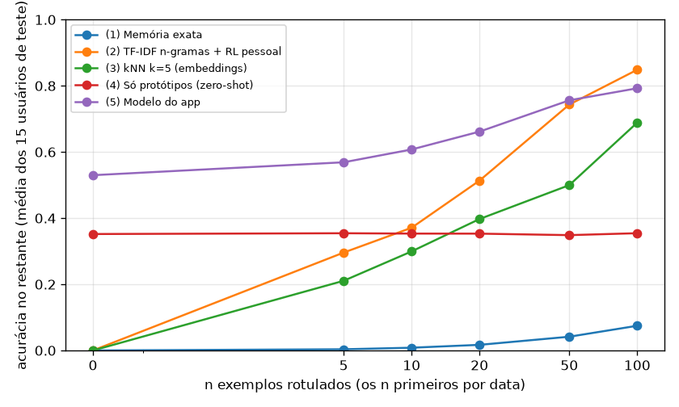

# Categorias personalizadas e prior genérico (Tarefa 2)

Gerado por `python avaliar_categorias.py` (números brutos em `categorias_personalizadas.json`).
Data: 2026-11-26. Embeddings do modelo do app (`assets/ia/modelo.onnx` int8 + `tokenizador.json`).

## Dados
50 usuários do FinIA (`data_gen.generate(n_per_arch=10, seed=42)`, só gastos), cada um com um esquema
sorteado (13/13/12/12): (a) 9 genéricas; (b) renomeadas; (c) agrupadas (Essenciais, Rolê, Transporte,
Outros); (d) renomeadas + "Pet" (3 gastos/mês de PETZ, COBASI, CLINICA VETERINARIA, AGROPET, e o
PET SHOP AMIGO FIEL do FinIA passa a ser Pet) + "Presentes" (2 gastos/mês de floricultura, Cacau Show,
loja de presentes e brinquedos). Divisão estratificada por esquema: 35 de validação e 15 de teste
(4/4/4/3). Hiperparâmetros e limiar escolhidos só na validação; o teste rodou uma vez.

Curva de aprendizado: transações de cada usuário em ordem de data; os n primeiros são rotulados, prevê-se
o resto. "Visto" = o `merchant` verdadeiro aparece entre os n primeiros.

## Prior genérico (`treinar_prior.py`)
RL multinomial (`LogisticRegression(C=1.0, max_iter=2000)`) sobre embeddings de 11114 gastos
do FinIA (sem os estabelecimentos Pet) → 9 genéricas. GroupKFold(5) por merchant (estabelecimento novo):

| Prior | Acurácia (estabelecimento novo) |
|---|---|
| Só embeddings | 0,441 |
| Prior + léxico do FinIA | 0,782 |

O léxico casa em 0,666 dos gastos e acerta 0,998
quando casa. **Número otimista:** o léxico contém nomes de estabelecimentos do próprio conjunto de teste
(netflix, spotify, uber, ifood, steam, shopee…), o que é vazamento no GroupKFold. O número honesto do
prior aprendido é o só-embeddings.

Na avaliação abaixo o prior de cada transação vem do modelo da dobra que **não** viu aquele merchant
(estabelecimentos Pet/Presentes, que não estão no FinIA, usam o modelo final, que também não os viu).

## Hiperparâmetros (validação, 35 usuários)
Grade: `pesoPrototipo` {1,3,10} × `alfaK` {5,10,20} × `lambdaL2` {1e-4,1e-3,1e-2} × `epocas` {100,150,300};
critério: acurácia média do modelo do app em n ∈ {5,10,20,50,100}.

| pesoPrototipo | alfaK | lambdaL2 | epocas | acurácia validação |
|---|---|---|---|---|
| 1 | 10 | 0.0001 | 300 | 0,685 |
| 1 | 10 | 0.001 | 300 | 0,684 |
| 1 | 20 | 0.0001 | 300 | 0,682 |
| 1 | 20 | 0.001 | 300 | 0,680 |
| 3 | 10 | 0.0001 | 300 | 0,675 |

Padrão do brief (3, 10, 1e-3, 150): 0,647. Escolhido: `pesoPrototipo`=1,
`alfaK`=10, `lambdaL2`=0.0001, `epocas`=300.

**`limiarSugestao` = 0,420**: menor limiar (passo 0,01) em que a precisão das sugestões
feitas é ≥ 0,85 na validação (todas as n juntas). Na validação: precisão 0,850,
cobertura 0,510 (fração dos lançamentos que recebe pré-seleção).

Mapeamento categoria → genérica (cos ≥ 0,5 com o vetor do nome genérico):

Mercado → Compras, Comida fora → Alimentação, Carro → Transporte, Casa → Moradia, Farmácia → Alimentação, Diversão → Outros, Estudos → Educação, Compras → Compras, Outros → Outros, Pet → — (não mapeada), Presentes → Outros, Essenciais → Saúde, Rolê → Moradia, Transporte → Transporte, Alimentação → Alimentação, Restaurantes e Delivery → Restaurantes e Delivery, Moradia → Moradia, Saúde → Saúde, Lazer e Assinaturas → Lazer e Assinaturas, Educação → Educação

## Resultados no teste (15 usuários, rodado uma vez)

### Acurácia × n (média entre usuários)

| Modelo | n=0 | n=5 | n=10 | n=20 | n=50 | n=100 |
|---|---|---|---|---|---|---|
| (1) Memória exata | 0,000 | 0,004 | 0,008 | 0,017 | 0,042 | 0,075 |
| (2) TF-IDF n-gramas + RL pessoal | 0,000 | 0,296 | 0,371 | 0,514 | 0,743 | 0,849 |
| (3) kNN k=5 (embeddings) | 0,000 | 0,211 | 0,299 | 0,397 | 0,500 | 0,689 |
| (4) Só protótipos (zero-shot) | 0,352 | 0,354 | 0,353 | 0,353 | 0,349 | 0,354 |
| (5) Modelo do app | 0,530 | 0,569 | 0,608 | 0,662 | 0,756 | 0,793 |

### F1 macro × n

| Modelo | n=0 | n=5 | n=10 | n=20 | n=50 | n=100 |
|---|---|---|---|---|---|---|
| (1) Memória exata | 0,000 | 0,005 | 0,012 | 0,026 | 0,056 | 0,104 |
| (2) TF-IDF n-gramas + RL pessoal | 0,000 | 0,154 | 0,238 | 0,376 | 0,613 | 0,748 |
| (3) kNN k=5 (embeddings) | 0,000 | 0,053 | 0,149 | 0,244 | 0,358 | 0,536 |
| (4) Só protótipos (zero-shot) | 0,324 | 0,326 | 0,325 | 0,325 | 0,319 | 0,330 |
| (5) Modelo do app | 0,488 | 0,519 | 0,553 | 0,592 | 0,650 | 0,651 |

### Acurácia por esquema (modelo × n × esquema)

| Modelo | n | (a) genéricas | (b) renomeadas | (c) agrupadas | (d) + Pet/Presentes |
|---|---|---|---|---|---|
| (1) Memória exata | 0 | 0,000 | 0,000 | 0,000 | 0,000 |
| (1) Memória exata | 5 | 0,002 | 0,005 | 0,005 | 0,003 |
| (1) Memória exata | 10 | 0,006 | 0,007 | 0,011 | 0,010 |
| (1) Memória exata | 20 | 0,015 | 0,015 | 0,015 | 0,026 |
| (1) Memória exata | 50 | 0,045 | 0,042 | 0,033 | 0,048 |
| (1) Memória exata | 100 | 0,069 | 0,083 | 0,069 | 0,079 |
| (2) TF-IDF n-gramas + RL pessoal | 0 | 0,000 | 0,000 | 0,000 | 0,000 |
| (2) TF-IDF n-gramas + RL pessoal | 5 | 0,267 | 0,272 | 0,394 | 0,236 |
| (2) TF-IDF n-gramas + RL pessoal | 10 | 0,336 | 0,343 | 0,475 | 0,316 |
| (2) TF-IDF n-gramas + RL pessoal | 20 | 0,474 | 0,492 | 0,639 | 0,427 |
| (2) TF-IDF n-gramas + RL pessoal | 50 | 0,747 | 0,756 | 0,801 | 0,646 |
| (2) TF-IDF n-gramas + RL pessoal | 100 | 0,861 | 0,846 | 0,870 | 0,807 |
| (3) kNN k=5 (embeddings) | 0 | 0,000 | 0,000 | 0,000 | 0,000 |
| (3) kNN k=5 (embeddings) | 5 | 0,173 | 0,182 | 0,271 | 0,217 |
| (3) kNN k=5 (embeddings) | 10 | 0,222 | 0,294 | 0,391 | 0,287 |
| (3) kNN k=5 (embeddings) | 20 | 0,342 | 0,421 | 0,502 | 0,300 |
| (3) kNN k=5 (embeddings) | 50 | 0,479 | 0,512 | 0,571 | 0,416 |
| (3) kNN k=5 (embeddings) | 100 | 0,679 | 0,731 | 0,732 | 0,587 |
| (4) Só protótipos (zero-shot) | 0 | 0,243 | 0,391 | 0,378 | 0,410 |
| (4) Só protótipos (zero-shot) | 5 | 0,243 | 0,395 | 0,380 | 0,414 |
| (4) Só protótipos (zero-shot) | 10 | 0,242 | 0,388 | 0,383 | 0,416 |
| (4) Só protótipos (zero-shot) | 20 | 0,244 | 0,387 | 0,381 | 0,417 |
| (4) Só protótipos (zero-shot) | 50 | 0,235 | 0,370 | 0,389 | 0,418 |
| (4) Só protótipos (zero-shot) | 100 | 0,243 | 0,382 | 0,385 | 0,425 |
| (5) Modelo do app | 0 | 0,718 | 0,561 | 0,393 | 0,419 |
| (5) Modelo do app | 5 | 0,700 | 0,600 | 0,458 | 0,500 |
| (5) Modelo do app | 10 | 0,676 | 0,636 | 0,546 | 0,560 |
| (5) Modelo do app | 20 | 0,682 | 0,682 | 0,651 | 0,621 |
| (5) Modelo do app | 50 | 0,755 | 0,781 | 0,768 | 0,708 |
| (5) Modelo do app | 100 | 0,775 | 0,814 | 0,817 | 0,754 |

### Estabelecimento já visto / novo (acurácia)

| Modelo | n=5 visto / novo | n=10 visto / novo | n=20 visto / novo | n=50 visto / novo | n=100 visto / novo |
|---|---|---|---|---|---|
| (1) Memória exata | 0,033 / 0,000 | 0,037 / 0,000 | 0,046 / 0,000 | 0,060 / 0,000 | 0,091 / 0,000 |
| (2) TF-IDF n-gramas + RL pessoal | 0,983 / 0,193 | 0,984 / 0,186 | 0,990 / 0,191 | 0,998 / 0,151 | 0,996 / 0,161 |
| (3) kNN k=5 (embeddings) | 0,497 / 0,168 | 0,587 / 0,211 | 0,602 / 0,256 | 0,646 / 0,154 | 0,805 / 0,148 |
| (4) Só protótipos (zero-shot) | 0,321 / 0,355 | 0,380 / 0,342 | 0,354 / 0,348 | 0,369 / 0,305 | 0,362 / 0,338 |
| (5) Modelo do app | 0,864 / 0,522 | 0,944 / 0,505 | 0,954 / 0,465 | 0,944 / 0,324 | 0,916 / 0,225 |

### Sugestões no teste (limiar 0,420)

| n | cobertura | precisão |
|---|---|---|
| 0 | 0,622 | 0,732 |
| 5 | 0,450 | 0,786 |
| 10 | 0,439 | 0,842 |
| 20 | 0,543 | 0,865 |
| 50 | 0,609 | 0,935 |
| 100 | 0,669 | 0,960 |
| todas | 0,545 | 0,844 |

## Leitura
- A memória exata do app (chave = descrição inteira sem acento) quase nunca acerta nestes dados: a descrição de
  extrato muda a cada compra (prefixo, número, cidade, erro de digitação). O TF-IDF de n-gramas acerta ~99% dos
  estabelecimentos já vistos com as mesmas descrições ruidosas.
- O modelo do app vence todos até n=50; em n=100 o TF-IDF + RL pessoal passa à frente (acurácia e F1). O ganho do
  modelo do app está no começo (prior + protótipos) e nos estabelecimentos novos.
- O mapeamento por cosseno do nome erra vários nomes (Mercado → Compras, Comida fora → Alimentação, Farmácia →
  Alimentação, Diversão → Outros, Rolê → Moradia, Essenciais → Saúde); é o que mais derruba os esquemas (b)–(d) em n=0.
- O melhor ponto da grade ficou na borda (pesoPrototipo=1, lambdaL2=1e-4, epocas=300): o modelo pessoal ainda está
  subajustado; a grade é a do plano e não foi estendida.
- O limiar é um só para todos os n; em n=0 a precisão das sugestões fica abaixo de 0,85.
- Os números do app em n=0 incluem o léxico, montado com nomes de estabelecimentos do próprio FinIA: são otimistas
  (ver a seção do prior, embeddings sem léxico).
- A vantagem sobre a memória exata depende do ruído das descrições sintéticas do FinIA; num extrato real com
  descrições estáveis a memória acertaria bem mais (e agora tem precedência no modelo do app).

## Especificação do modelo do app (a T5 replica exatamente)

Entradas: categorias da pessoa `c = 0..C-1` com `vetorNome_c = vetorizar(normalizar_para_modelo(nome_c))`;
exemplos rotulados `(x_i, y_i)` (só de categorias que ainda existem; `n` = quantos são);
`x = vetorizar(normalizar_para_modelo(descricao))` (vetores L2-normalizados, 384).

1. **Modelo pessoal.** Treino = exemplos (peso 1) + um protótipo por categoria `(vetorNome_c, c, peso = pesoPrototipo)`.
   `W = 0 (C×384)`, `b = 0`. Por `epocas` épocas, lote completo, `taxa`:
   `P = softmax(X·Wᵀ + b)` (por linha, subtraindo o máximo); `G_ic = peso_i · (P_ic − 1[y_i=c]) / Σ peso`;
   `W ← W − taxa · (Gᵀ·X + lambdaL2 · W)`; `b ← b − taxa · Σ_i G_i` (viés sem L2). `p_pessoal = softmax(W·x + b)`.
2. **Distribuição genérica `s` (9).** Léxico: `t = sem_acento(normalizar_para_modelo(descricao))`, onde
   `normalizar_para_modelo` (NFKC, minúsculas, `[\d\W_]` → espaço) já tirou as sequências de cidades e as palavras de
   BOILERPLATE antes do match, e `sem_acento(u) = NFKD(u)` codificado em ASCII **descartando** o que não for ASCII
   (`unicodedata.normalize("NFKD", u).encode("ascii", "ignore")`: ø, ß e símbolos somem, não viram letra). Um termo
   casa se aparece como **palavra(s) inteira(s)**: `(" " + termo + " ")` contido em `(" " + t + " ")` (termos de duas
   palavras, como "smart fit", casam a sequência; "prime" não casa "primeiro"). Se algum casa, `g*` = a categoria de **menor
   índice em `generico.nomes`** entre as que casaram (é a ordem "1º acerto vence" do FinIA) e
   `s_g = (1 − confiancaLexico)/9 + confiancaLexico · 1[g = g*]`. Se nenhum casa, `s = softmax(pesos·x + vieses)`.
3. **Mapeamento.** `g(c) = argmax_g cos(vetorNome_c, vetoresNomes_g)` se esse máximo ≥ `similaridadeMinimaMapeamento`;
   senão `c` é não mapeada.
4. **Prior nas categorias da pessoa.** `q_c = s_{g(c)} / #{c' : g(c') = g(c)}` para as mapeadas; as não mapeadas
   dividem igualmente `Σ s_g` das genéricas que nenhuma categoria pegou. `q ← q / Σ q` (se `Σ q = 0`, uniforme).
   `z_c = softmax_c(cos(x, vetorNome_c) / temperaturaPrior)`. `prior = 0,5·q + 0,5·z`.
5. **Mistura.** `α = n / (n + alfaK)`; `p_final = α·p_pessoal + (1 − α)·prior` (soma 1).
6. **Precedência da memória exata.** Se a chave do estabelecimento da transação (`chaveDoEstabelecimento`: NFD, tira
   `\p{M}`, minúsculas, espaços colapsados, trim) já foi rotulada pela pessoa (o rótulo mais recente vale), esse
   rótulo vence antes de qualquer modelo: `p_final` vira one-hot nele e ele é sempre sugerido (ignora limiar e
   `minimoExemplos`). Assim o léxico nunca sobrepõe um rótulo da pessoa para o mesmo estabelecimento.
7. **Sugestão.** Sem memória: `c* = argmax p_final`; sugere se `p_final[c*] ≥ limiarSugestao` **e** (`c*` tem
   ≥ `minimoExemplos` exemplos rotulados **ou** `c*` é mapeada).

Referência numérica para a T5: `app/src/test/resources/ia/golden_classificador.json` (gerado por
`python gerar_golden_classificador.py` com `modelo_app`): entradas pequenas e todos os intermediários (`mapa`, `genericaLexico`,
`s`, `prior`, `pPessoal`, `alfa`, `rotuloMemoria`, `pFinal`, `sugestao`).

Python usa float64; em Float (Kotlin) as probabilidades devem bater em ~1e-4.
